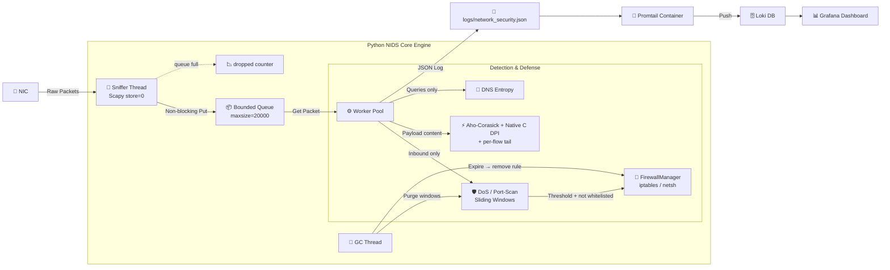

<h1 align="center"> 🕵️ WireWarden – Hybrid Python/C NIDS & Observability Engine </h1>

<p align="center">
  A full end-to-end real-time <strong>Network Intrusion Detection & Prevention System (NIDS/NIPS)</strong>.
  <br>
  Combines a multi-threaded Python (Scapy) capture and analysis engine with a dual-layer DPI pipeline — an <strong>Aho-Corasick automaton</strong> for cleartext-credential patterns and a <strong>native C library</strong> (bounds-checked, called live via <code>ctypes</code>) for injection-pattern signatures — plus sliding-window anomaly detection, time-limited OS-firewall Active Defense, and a fully code-managed monitoring stack (<strong>Dashboard as Code</strong>) on <strong>Docker (Grafana + Loki + Promtail)</strong>.
  <br>
  <sub>Unit-tested (pytest), memory-fuzzed (ASan + UBSan) and CI-gated. Limitations are documented below.</sub>
</p>

<p align="center">
  <a href="https://github.com/RazEini/WireWarden/actions/workflows/ci.yml"></a>
  
  
  
  
  
  
  
  
  
</p>

<p align="center">
  <a href="#overview">Overview</a> ·
  <a href="#dashboard">Dashboard</a> ·
  <a href="#performance">Performance</a> ·
  <a href="#dpi-engines">DPI</a> ·
  <a href="#structure">Structure</a> ·
  <a href="#features">Features</a> ·
  <a href="#technologies">Technologies</a> ·
  <a href="#quick-start">Quick Start</a> ·
  <a href="#testing">Testing</a> ·
  <a href="#audit">Audit</a> ·
  <a href="#limitations">Limitations</a>
</p>

---

## ✨ At a Glance

| | |
| :--- | :--- |
| **Detects** | SYN floods, port scans, stealth scans (NULL / FIN / XMAS), DNS tunneling, injection attempts (SQLi, XSS, path traversal, command injection) and cleartext credentials |
| **Responds** | Time-limited `iptables` / `netsh` blocks, removed on expiry and on shutdown, with a never-block list and a `--dry-run` mode |
| **DPI speed** | C engine ≈ **1M packets/s per call** and ≈ **4M packets/s in batch**, versus ≈ 190K packets/s for a pure-Python loop (Windows, Python 3.13) |
| **Quality** | 46 pytest tests, C engine fuzzed under AddressSanitizer + UBSan, CI on every push |
| **Honest about limits** | [Known limitations](#limitations) and the [bugs found by auditing my own code](#audit) are documented, not hidden |

---

<a id="overview"></a>
## 🔎 Overview & Architecture

**WireWarden** monitors, analyzes, and responds to network security events across OSI layers 3, 4, and 7.
The architecture is a continuous Producer-Consumer pipeline that separates low-level packet capture, real-time threat analysis, and structured observability shipping.

> **Architecture Highlight:** WireWarden runs a **dual-layer DPI pipeline**: an Aho-Corasick automaton for cleartext-credential keywords, and a native C library (`ctypes`) for injection signatures. Payloads are selected **by content** — ciphertext (TLS/SSH) is skipped by a printable-ASCII heuristic, not by port — so plaintext attacks on any port are still inspected.



---

<a id="dashboard"></a>
## 📊 Dashboard Preview

Live view of the **WireWarden Security Overview** Grafana dashboard, provisioned automatically from code.

<p align="center">
  
  <br><em>Live JSON log stream with DNS query events, alongside real-time Security Events Distribution and Threat Timeline panels.</em>
</p>

<p align="center">
  
  <br><em>Active Defense in action — a DoS/SYN Flood attack triggers automatic IP isolation, alongside a DNS Tunneling detection alert (Shannon entropy-based).</em>
</p>

<p align="center">
  
  <br><em>Full event-type breakdown (Port Scans, Stealth Scans, DPI Alerts, DoS Attacks) with Top Suspicious Source IPs and Total Security Alerts panels.</em>
</p>

---

<a id="performance"></a>
## ⚡ Performance & Resilience Analysis

- **Memory Backpressure & Counted Drops** — A bounded `Queue(maxsize=20000)` combined with `store=0` in Scapy keeps memory bounded: the sniffer never accumulates packets, and the queue holds at most 20,000. When analysis falls behind, excess packets are dropped rather than risking Out-Of-Memory crashes — and every drop is **counted** and reported (`[STATS] captured=… dropped=…`), so loss is visible, not silent.
- **Concurrency Model (honest)** — Workers are threads, so under CPython's GIL the pure-Python analysis does **not** run in parallel. Threads decouple capture from analysis and overlap work that releases the GIL (socket reads, the `ctypes` call into C). Scaling analysis across cores would require multiprocessing.
- **Thread Safety via a Shared Lock** — Shared state (`syn_history`, `port_history`, `blacklist`) is protected by a single `threading.Lock` for atomic updates. All time windows use `time.monotonic()`, so wall-clock changes (NTP, DST) cannot corrupt them.
- **Active Defense & OS Firewall Integration** — Dynamic OS firewall rules (`iptables` on Linux, `netsh advfirewall` on Windows) are applied on a DoS verdict in a background thread, so slow firewall commands don't stall the worker. Blocks are **time-limited**: the rule is removed when the block expires and on shutdown, and the log reports what the OS actually returned (applied / FAILED + stderr). A never-block list (loopback, this host, default gateway, `--whitelist`) and a `--dry-run` mode guard against self-inflicted outages.
- **Deterministic Resource Cleanup (Garbage Collector)** — Dormant IP records, expired blacklist entries and stale flow tails are purged every 30 seconds by a background thread, keeping memory steady under sustained traffic.

---

<a id="dpi-engines"></a>
## 🔬 DPI Engines: Live Detection vs. Throughput Benchmark

WireWarden runs **two DPI engines together** in the live pipeline (`main.py`), each covering a different signature class, plus a standalone script that measures the C engine's throughput in isolation:

| | **Live: Aho-Corasick (`KeywordEngine`)** | **Live: Native C (`NativeSignatureEngine`)** | **Standalone: `benchmark_dpi.py`** |
| :--- | :--- | :--- | :--- |
| Technology | `pyahocorasick` automaton, substring fallback if unavailable | Native C via `ctypes`, loaded once in `NetworkGuardian.__init__` | Same `libdpi` shared library, loaded independently |
| Where it runs | `NetworkGuardian._check_dpi`, on every plaintext-looking payload | `NetworkGuardian._check_dpi`, on every plaintext-looking payload | Standalone script only — not imported by `main.py` |
| Signature set | `password=`, `passwd=`, `pwd=`, `authorization: basic`, `api_key=`, `apikey=`, `select * from` | 14 case-insensitive signatures: SQLi, XSS, path traversal, command injection, sensitive files (defined once in `c_src/dpi.c`, read back by Python) | Same as the live C engine |
| Purpose | Cleartext credential / query leak alerting | Injection-pattern alerting | Measuring C vs. pure-Python throughput |
| Required? | Recommended (`pip install pyahocorasick`) | Optional — compile with `make -C c_src`; without it WireWarden runs on keyword DPI only | N/A — dev/benchmark tool |

Both engines apply to the **same normalized payload**: URL-decoded (`%2e%2e%2f` → `../`), and joined with a short per-flow tail so a signature split across two consecutive TCP segments is still caught.

---

<a id="benchmark"></a>
## 🏎️ DPI Native C Engine Performance

- **Single-pass, bounds-checked scan** — A 256-entry first-byte table rejects most bytes with one lookup; only candidate positions are compared. A signature is compared only if it fits inside the buffer, so no read can pass `payload_len - 1` — safe on raw, non-NUL-terminated binary traffic. Verified by fuzzing under ASan/UBSan.
- **Honest 4-way benchmark** — `benchmark_dpi.py` asserts all engines agree, then times the same 14 signatures (all case-insensitive) on 100,000 packets:

| Engine | Time | Throughput | vs. naive |
| :--- | :--- | :--- | :--- |
| Python loop (lowercase + `sig in payload`) | `0.526 s` | `190,179 pkt/s` | 1.00x |
| Python regex (one compiled alternation, `IGNORECASE`) | `0.546 s` | `183,100 pkt/s` | 0.96x |
| **C, per-call via `ctypes` (what the live pipeline does)** | `0.095 s` | `1,055,043 pkt/s` | **5.55x** |
| **C, batch (one FFI call for all packets)** | `0.024 s` | `4,142,193 pkt/s` | **21.78x** |

*Representative run on Windows, Python 3.13. Across four runs the C engine was stable (per-call 0.09–0.11 s) while the pure-Python baseline varied (0.50–0.68 s), so the speedup ranged ≈4.7–7.3x per call and ≈19.5–27.4x in batch. Re-run `benchmark_dpi.py` on your machine.*

> **How to read it:** the batch row is the engine's ceiling with FFI overhead amortized. The live pipeline calls C once per packet, so **the per-call row is the honest estimate for `main.py`**. Neither is end-to-end NIDS throughput, which also includes Scapy dissection and queueing.

> **Run Benchmark Locally:**
> ```bash
> # Linux / macOS
> make -C c_src
> # Windows (GCC) — requires MinGW/MSYS2 installed
> gcc -shared -O3 -o libdpi.dll c_src/dpi.c
>
> python benchmark_dpi.py
> ```

---

<a id="structure"></a>
## 📂 Project Structure

```text
WireWarden/
├── assets/                          # Static Documentation Assets (Dashboard Screenshots)
│   ├── dashboard_overview.png
│   ├── dashboard_threat_detection.png
│   └── dashboard_analytics.png
├── c_src/                           # Low-Level Native C Extensions
│   ├── dpi.c                        # Native C DPI Engine (single-pass, case-insensitive, bounds-checked)
│   ├── fuzz_dpi.c                   # ASan/UBSan fuzz harness
│   └── Makefile                     # Build setup + `make fuzz`
├── grafana/
│   ├── dashboards/                  # Standard JSON Dashboard (Git Version-Controlled)
│   │   └── dashboard-WireWarden Security Overview.json
│   └── provisioning/                # Grafana Automated Provisioning Configs
│       ├── dashboards/dashboards.yml
│       └── datasources/datasources.yml
├── tests/                           # pytest: detection logic, native engine, firewall manager
│   ├── conftest.py
│   ├── test_detection.py
│   └── test_dpi_native.py
├── .github/workflows/ci.yml         # Build (-Werror) + pytest + ASan/UBSan fuzz
├── logs/                            # Runtime Log Directory (Ignored by Git, not tracked)
├── .env.example
├── .gitignore
├── LICENSE
├── README.md
├── benchmark_dpi.py                 # Honest 4-way DPI micro-benchmark
├── docker-compose.yml
├── main.py                          # NIDS Core Engine (NetworkGuardian, FirewallManager, DPI engines)
├── promtail-config.yml
├── requirements.txt / requirements-dev.txt
└── test_attack.py                   # Live Traffic Simulator
```

---

<a id="features"></a>
## 🚀 Core Features

| Domain | Feature | Status | Description | Performance Indicator |
| :--- | :--- | :---: | :--- | :--- |
| 📡 **Network** | Real-time L3-L7 Sniffing | ✅ | Real-time capture and analysis of IP, TCP, UDP, and DNS traffic while keeping memory bounded (`store=0`, bounded queue). | Bounded memory, O(1) enqueue, counted drops |
| 🛡️ **Cyber Security** | Sliding-Window & Stealth Detection | ✅ | Detects **DoS (SYN Flood — pure SYN only, replies excluded)**, port scans (per `(protocol, port)`), and **Stealth Scans (NULL, FIN, XMAS)**. DoS/scan windows count **inbound** traffic only. | O(1) window updates |
| 🧬 **DNS Security** | DNS Tunneling Detection | ✅ | Shannon entropy and length of the leftmost label, on **queries only** (responses are skipped so the resolver is never blamed). | O(L) per label |
| ⚡ **Active Defense** | Time-limited IP Isolation & OS Firewall | ✅ | Adds `netsh` / `iptables` rules on a DoS verdict, **removes them on expiry and shutdown**, never blocks whitelisted/local/gateway addresses, supports `--dry-run`, and logs the real command result. | Non-blocking (background thread), O(1) blacklist check |
| 🔍 **DPI Engine** | Deep Packet Inspection | ✅ | Dual-layer L7 scanning: Aho-Corasick for cleartext-credential patterns, plus a native C library (`ctypes`) for 14 case-insensitive injection signatures. URL-decoding and cross-segment matching included. Falls back to Aho-Corasick alone if the C library isn't built. | O(N+M) keyword match; C path ≈5x (per-call) / ≈20x (batch) vs. naive Python |
| ⚙️ **Architecture** | Producer-Consumer & Thread-Safety | ✅ | Bounded `Queue`, a shared `threading.Lock`, monotonic-time windows, and a dedicated GC thread. | Bounded queue, backpressure with counted drops |
| 📊 **Observability & IaC** | Dashboard as Code (Grafana + Loki) | ✅ | A single all-in-one "WireWarden Security Overview" dashboard in standard JSON, auto-loaded on container startup via provisioning files. | Instant provisioning on boot |
| 📝 **Logging** | Structured JSON Dual-Stream | ✅ | Colorized console output alongside structured JSON log writes (`logs/network_security.json`), tailored for Promtail. | Promtail-ready labels: level, event_type, src_ip |
| 🧪 **Testing** | pytest + Fuzzing + Simulator | ✅ | 46 pytest tests (detection, native engine, firewall for iptables and netsh, lab mode), C engine fuzzed under ASan/UBSan, and `test_attack.py` for live end-to-end validation (including a SYN-ACK negative control). | CI-gated |

---

<a id="technologies"></a>
## 🛠️ Technologies & Architectural Highlights

- **Python & Scapy** — Raw-socket-level packet capture, protocol parsing, and deep payload-level inspection (DPI).
- **Aho-Corasick DPI (live)** — Multi-pattern automaton (`pyahocorasick`) in `main.py` for real-time matching of cleartext-credential patterns, with a substring fallback when the library is unavailable.
- **Native C Library (ctypes, live)** — Memory-bounds-checked, single-pass, case-insensitive C scanner loaded via `ctypes` in `NetworkGuardian.__init__` and called per payload. Its signature table is the single source of truth (Python reads names back through `signature_count()` / `signature_name()`). Requires `make -C c_src`; WireWarden degrades gracefully to keyword DPI if the library isn't built.
- **Producer-Consumer Architecture** — Capture and analysis are separated by `queue.Queue(maxsize=20000)`; when full, packets are dropped and counted instead of growing memory.
- **Thread-Safety & Active Defense** — Blacklist/whitelist and window state guarded by `threading.Lock`, integrated with background OS firewall rule injection and automatic removal (`netsh` / `iptables`).
- **Background Garbage Collector** — A dedicated thread cleans stale sliding-window history, expired blacklist entries and idle flow tails every 30 seconds, keeping memory bounded for dormant IPs.
- **Promtail & Grafana Loki** — Structured JSON logs shipped from the local logs directory and indexed in Loki.
- **Dashboards as Code (IaC)** — The "WireWarden Security Overview" dashboard is version-controlled under `grafana/dashboards/` and auto-loaded into Grafana on container startup.
- **Docker Compose Stack** — One-command deployment of the observability stack (Loki and Grafana bound to `127.0.0.1`, Grafana version pinned, admin password required).

---

<a id="entropy"></a>
### 🧬 Algorithmic Detection: Shannon Entropy for DNS Tunneling

WireWarden identifies covert communication and data exfiltration over DNS by measuring the randomness (entropy) of the leftmost label of each DNS **query**.

Ordinary domain names follow predictable natural-language patterns, whereas encoded data streams (e.g. Base64/Hex DNS tunneling) produce much higher entropy.

- **Mathematical Model:**
  Shannon Entropy $H(X)$ over the character distribution of the label:
  $$H(X) = -\sum_{i=1}^{n} P(x_i) \log_2 P(x_i)$$
- **Detection Rule:** a query is flagged when the label's $H(X) > 4.3$ **or** its length exceeds 45 characters.
- **Why both conditions:** entropy of an $L$-character label cannot exceed $\log_2 L$ bits, so $H > 4.3$ is only reachable for labels of about 20+ characters. Short labels can't trigger it, which keeps ordinary hostnames quiet; the length rule catches very long labels regardless of their character mix.

---

<a id="prerequisites"></a>
## 📋 Prerequisites

- **Git** — Required to clone the repository.
- **Docker & Docker Compose** — For running Loki, Promtail, and Grafana.
- **Python 3.10+** — Required for the NIDS engine and test suite.
- **GCC / Make** — Required to compile the native C DPI library (`libdpi.so` on Linux, `libdpi.dylib` on macOS, `libdpi.dll` on Windows). Recommended before running `main.py`; also needed for `benchmark_dpi.py` and the tests. Without it WireWarden still runs on keyword DPI alone.
- **`pyahocorasick`** — Recommended for the keyword engine; a substring fallback is used automatically if it's missing.
- **Administrator / Root Privileges** — Required to capture raw sockets via Scapy and to inject OS firewall rules (or use the least-privilege `setcap` option below on Linux for capture).
- **`tcpdump` or `libpcap` (Linux)** — Scapy needs it to compile the `ip` capture filter. Without it `sniff()` fails on startup.
- **Npcap (Windows only)** — Required for Scapy to capture raw packets on Windows adapters.

---

<a id="logs"></a>
## 📝 JSON Log Structure (Structured Logging)

```json
{
  "timestamp": "2026-10-20T10:30:15.123456+03:00",
  "level": "WARNING",
  "message": "[PORT SCAN DETECTED] Host 203.0.113.7 probed 61 unique ports",
  "logger": "NetworkGuardian",
  "src_ip": "203.0.113.7",
  "event_type": "PORT_SCAN",
  "details": "61 ports scanned"
}
```

Event types: `PORT_SCAN`, `STEALTH_SCAN`, `DOS_ATTACK`, `DOS_ATTACK_WHITELISTED`, `DNS_TUNNELING`, `DNS_QUERY`, `DPI_ALERT`, `DPI_ALERT_NATIVE`, `FIREWALL_BLOCK`, `FIREWALL_UNBLOCK`, `FIREWALL_ERROR`, `FIREWALL_DRY_RUN`, `ENGINE_STATS`.

---

<a id="quick-start"></a>
## ⚙️ Installation & Quick Start

```bash
# 1. Clone the repository
git clone https://github.com/RazEini/WireWarden.git
cd WireWarden

# 2. Environment Setup
cp .env.example .env  # Set GRAFANA_ADMIN_PASSWORD — docker compose refuses to start without it

# 3. Start Observability Stack (Grafana, Loki, Promtail)
# Grafana automatically provisions all dashboards from grafana/dashboards/
docker compose up -d

# 4. Setup Python Environment
python -m venv .venv
.\.venv\Scripts\activate     # On Windows
source .venv/bin/activate    # On Linux/Mac
pip install -r requirements.txt

# 5. Compile the Native C DPI Library (recommended)
# main.py auto-detects and loads it at startup; without it WireWarden runs on keyword DPI only.
make -C c_src                                          # Linux / macOS
gcc -shared -O3 -o libdpi.dll c_src/dpi.c              # Windows — requires MinGW/MSYS2

# Optional: run the standalone benchmark
python benchmark_dpi.py
```

### 6a. Run NIDS Engine — Linux / macOS

```bash
# Safe first run: full detection, but never touches the firewall
sudo .venv/bin/python main.py --dry-run

# Principle of Least Privilege - grant raw-socket capability without full sudo
# (firewall rules still need root, so combine with --dry-run if not running as root):
sudo setcap cap_net_raw,cap_net_admin=eip $(readlink -f .venv/bin/python)
.venv/bin/python main.py --dry-run

# Real run with active defense and a never-block range:
sudo .venv/bin/python main.py --whitelist 10.0.0.0/24
```

### 6b. Run NIDS Engine — Windows

```powershell
# Run PowerShell / CMD as Administrator:
python main.py --dry-run
python main.py --whitelist 10.0.0.0/24
```

| Flag | Default | Meaning |
| :--- | :--- | :--- |
| `--dry-run` | off | Log what *would* be blocked; never run firewall commands |
| `--whitelist A,B/CIDR` | – | Extra never-block addresses (this host, gateway and loopback are automatic) |
| `--include-outbound` | off | **Lab mode:** also count traffic this host *sends*. Needed when `test_attack.py` targets another device such as your router (see below) |
| `--block-seconds` | 300 | How long a DoS source stays blocked |
| `--dos-threshold` / `--scan-threshold` | 500 / 50 | Events per 10-second window |
| `--workers` / `--iface` | 4 / default | Worker threads / interface to sniff |

### 7. Run Attack Simulator (in a separate terminal)

```bash
# Automatically targets local active IP:
python test_attack.py

# Or target a specific IP address explicitly:
python test_attack.py <TARGET_IP>
```

📊 **Accessing Grafana:** open [http://localhost:3000](http://localhost:3000) (username: `admin`, password from `.env`). All dashboards load automatically.

### Which traffic counts? (inbound vs. outbound)

DoS and port-scan windows count **inbound** traffic only, meaning packets whose destination is one of this machine's own addresses. Your own outbound traffic and replies must never look like an attack. DPI, stealth-scan and DNS-tunneling detection look at traffic in both directions.

That matters for the simulator. `test_attack.py` run **without an argument** targets your own IP, so every detector fires, including the red DoS block. If you point it at **another device** (e.g. your router), those packets leave your machine, so the DoS and port-scan alerts are skipped on purpose. To demo against another device, add the lab flag:

```bash
python main.py --include-outbound --dry-run     # --dry-run: alerts only, no firewall rule
python test_attack.py 192.168.1.1               # router / other device
```

---

<a id="testing"></a>
## 🧪 Testing & Quality Gates

```bash
pip install -r requirements-dev.txt
make -C c_src
python -m pytest tests -v        # 46 tests: detection logic, DPI engines, firewall manager (iptables + netsh), lab mode
make -C c_src fuzz ITER=1000000  # C engine under AddressSanitizer + UndefinedBehaviorSanitizer
```

- **Regression tests** pin every defect found during the project's own audit (see the table below). Each test was verified to fail when its bug is reintroduced.
- **Firewall tests** verify the exact `iptables` and `netsh` commands that get built, that add and delete use the same rule name, and that a failed command is never recorded as applied. They use an injected command runner, so they prove command construction, not the OS's reaction — that needs a manual run with admin rights. The `netsh` commands were also run manually on Windows.
- **Fuzzing** allocates every buffer at its exact size, so an out-of-bounds read is an ASan failure. It covers truncated and upper-cased signatures placed flush against the end of the buffer.
- **CI** (`.github/workflows/ci.yml`) builds the C library with `-Wall -Wextra -Werror`, runs pytest on Python 3.10 and 3.12, and runs the ASan/UBSan fuzzer.
- **`test_attack.py`** is a live simulator (synthetic traffic only) that exercises the real sniff path and the Grafana dashboards, including a SYN-ACK **negative control** that must not alert.

<a id="audit"></a>
### 🐞 Bugs Found by Auditing My Own Code

After the first working version I audited it, reproduced each problem with a test, and fixed it. Every row has a regression test.

| Defect | Impact | Fix |
| :--- | :--- | :--- |
| SYN-ACK counted as SYN | A busy server answering clients was blocked as a "DoS" source | Count only SYN without ACK |
| Outbound traffic counted | The host's own connections and replies looked like attacks | DoS and port-scan windows count inbound only |
| DNS responses inspected | The alert blamed the resolver instead of the asking host | Inspect queries only |
| Firewall rules never removed | The log said "5 minutes" but the rule lasted forever | Track rules; remove on expiry and on shutdown |
| "Rule applied" logged before the command ran | A failed `iptables` / `netsh` looked like success | Log the real exit status and stderr |
| DPI skipped ports like 443 | Plaintext attacks on those ports slipped through | Choose payloads by content, not by port |
| Case-sensitive signatures | `union select` in lowercase evaded detection | ASCII case-insensitive matching in C |
| No handling of split segments | A signature cut across two packets evaded detection | Per-flow tail carried between segments |
| Log handlers added on every engine start | Duplicate log lines | Add handlers only once |

---

<a id="limitations"></a>
## ⚠️ Known Limitations

WireWarden is a learning-grade IDS, not a replacement for Suricata or Zeek. Specifically:

- **Not a full TCP reassembler.** A short per-flow tail catches signatures split across *consecutive, in-order* segments. Out-of-order, retransmitted, or heavily fragmented streams are not reassembled.
- **Signature-based.** 14 literal patterns catch common, unobfuscated payloads. Comment-based SQL (`UNION/**/SELECT`), double encoding and similar obfuscation will evade them.
- **IP spoofing.** SYN floods use forged sources by nature, so blocking the "source" can block an innocent address. Mitigations: whitelist critical infrastructure, time-limited blocks, `--dry-run`.
- **IPv4 only**, and no TLS inspection (encrypted payloads are skipped by design).
- **Static thresholds** (`--dos-threshold`, `--scan-threshold`) need tuning per network.
- **Direction needs local addresses.** If none can be discovered, all traffic is treated as inbound.

---

## 📄 License

This project is distributed under the **MIT** license – free to use and modify for educational and research purposes.

---

<p align="center"><strong>👨‍💻 Raz Eini (2026)</strong></p>
