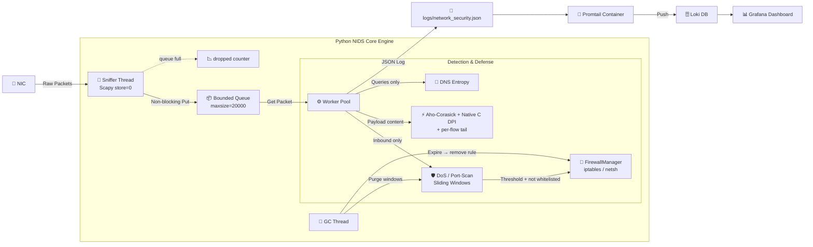

<h1 align="center">🕵️ WireWarden</h1>
<p align="center"><strong>Real-time network intrusion detection &amp; prevention in Python and C, with a Grafana dashboard provisioned from code.</strong></p>

<p align="center">
  <a href="https://github.com/RazEini/WireWarden/actions/workflows/ci.yml"></a>
  
  
  
  
  
  
</p>

<p align="center">
  <a href="#overview">Overview</a> ·
  <a href="#dashboard">Dashboard</a> ·
  <a href="#features">Features</a> ·
  <a href="#dpi">DPI</a> ·
  <a href="#design">Design</a> ·
  <a href="#quick-start">Quick Start</a> ·
  <a href="#testing">Testing</a> ·
  <a href="#audit">Audit</a> ·
  <a href="#limitations">Limitations</a>
</p>

---

## ✨ At a Glance

| | |
| :--- | :--- |
| **Detects** | SYN floods, port scans, stealth scans (NULL / FIN / XMAS), DNS tunneling, injection attempts (SQLi, XSS, path traversal, command injection) and cleartext credentials |
| **Responds** | Time-limited `iptables` / `netsh` blocks, removed on expiry and on shutdown, with a never-block list and a `--dry-run` mode |
| **DPI speed** | C engine ≈ **1M packets/s per call** and ≈ **4M packets/s in batch**, versus ≈ 190K packets/s for a pure-Python loop (Windows, Python 3.13) |
| **Quality** | 46 pytest tests, C engine fuzzed under AddressSanitizer + UBSan, CI on every push |
| **Honest about limits** | [Known limitations](#limitations) and the [bugs found by auditing my own code](#audit) are documented, not hidden |

---

<a id="overview"></a>
## 🔎 Overview & Architecture

WireWarden analyzes live traffic across OSI layers 3, 4 and 7. A Scapy capture thread feeds a bounded queue, worker threads run the detectors, and structured JSON logs flow through Promtail and Loki into Grafana.



---

<a id="dashboard"></a>
## 📊 Dashboard

The **WireWarden Security Overview** dashboard loads automatically from `grafana/dashboards/` when the stack starts.

<p align="center">
  
  <br><em>Live JSON log stream, security-event distribution and threat timeline.</em>
</p>
<p align="center">
  
  <br><em>A SYN flood triggers automatic IP isolation, next to a DNS-tunneling alert.</em>
</p>
<p align="center">
  
  <br><em>Event-type breakdown, top suspicious source IPs and total alerts.</em>
</p>

---

<a id="features"></a>
## 🚀 Core Features

| Domain | Feature | Description | Performance |
| :--- | :--- | :--- | :--- |
| 📡 **Network** | Real-time L3–L7 sniffing | Captures IP, TCP, UDP and DNS traffic with bounded memory (`store=0`, bounded queue). | O(1) enqueue, counted drops |
| 🛡️ **Cyber Security** | Sliding-window & stealth detection | **SYN flood** (SYN without ACK; replies excluded), **port scans** (per `(protocol, port)`), **NULL / FIN / XMAS scans**. DoS and scan windows count **inbound** traffic only. | O(1) window updates |
| 🧬 **DNS Security** | DNS tunneling detection | Shannon entropy and length of the leftmost label, on **queries only** (responses are skipped, so the resolver is never blamed). | O(L) per label |
| ⚡ **Active Defense** | Time-limited IP isolation | Adds `iptables` / `netsh` rules on a DoS verdict, **removes them on expiry and shutdown**, never blocks whitelisted / local / gateway addresses, supports `--dry-run`, and logs the real command result. | Background thread, O(1) blacklist check |
| 🔍 **DPI** | Deep packet inspection | Aho-Corasick for cleartext credentials plus a native C library for 14 case-insensitive injection signatures, with URL-decoding and cross-segment matching. See [DPI](#dpi). | ≈5x (per call) / ≈20x (batch) vs. naive Python |
| 📊 **Observability** | Dashboard as Code | One Grafana dashboard stored as JSON and auto-loaded through provisioning files; structured JSON logs shipped by Promtail to Loki. | Provisioned on startup |

<details>
<summary><strong>DNS tunneling: the entropy rule</strong></summary>

Ordinary hostnames follow predictable patterns, while encoded data (Base64 or hex) produces high entropy. For the leftmost label of a query:

$$H(X) = -\sum_{i=1}^{n} P(x_i) \log_2 P(x_i)$$

A query is flagged when $H(X) > 4.3$ **or** the label is longer than 45 characters. Both conditions are needed: the entropy of an $L$-character label cannot exceed $\log_2 L$ bits, so $H > 4.3$ is only reachable for labels of about 20+ characters. The length rule catches very long labels regardless of their character mix.
</details>

---

<a id="dpi"></a>
## 🔬 DPI Pipeline

Every plaintext-looking payload goes through two engines. Payloads are chosen **by content** (a printable-ASCII heuristic), not by port, so TLS and SSH ciphertext is skipped while plaintext attacks on 443 or 8443 are still inspected.

| | Aho-Corasick (`KeywordEngine`) | Native C (`NativeSignatureEngine`) |
| :--- | :--- | :--- |
| **Finds** | Cleartext credential and query leaks | Injection patterns: SQLi, XSS, path traversal, command injection, sensitive files |
| **Technology** | `pyahocorasick` automaton, substring fallback if missing | C library called through `ctypes` |
| **Signatures** | `password=`, `passwd=`, `pwd=`, `authorization: basic`, `api_key=`, `apikey=`, `select * from` | 14, defined once in `c_src/dpi.c` and read back by Python |
| **Required** | Installed by `requirements.txt` | Optional: `make -C c_src`. Without it, keyword DPI still runs. |

Both engines scan the same normalized payload: URL-decoded (`%2e%2e%2f` becomes `../`) and joined with a short per-flow tail, so a signature split across two consecutive TCP segments is still caught.

**The C engine** makes a single pass over the buffer. A 256-entry first-byte table rejects most bytes with one lookup, and a signature is compared only if it fits inside the buffer, so no read can pass `payload_len - 1`. That makes it safe on raw, non-NUL-terminated traffic, and fuzzing under ASan/UBSan confirms it.

`python benchmark_dpi.py` asserts that all engines agree, then times the same 14 case-insensitive signatures on 100,000 packets:

| Engine | Time | Throughput | vs. naive |
| :--- | :--- | :--- | :--- |
| Python loop (lowercase + `sig in payload`) | 0.526 s | 190,179 pkt/s | 1.00x |
| Python regex (one compiled alternation, `IGNORECASE`) | 0.546 s | 183,100 pkt/s | 0.96x |
| **C, per call via `ctypes`** (what the live pipeline does) | 0.095 s | 1,055,043 pkt/s | **5.55x** |
| **C, batch** (one call for all packets) | 0.024 s | 4,142,193 pkt/s | **21.78x** |

*Representative run on Windows, Python 3.13. Across four runs the C engine was stable (0.09–0.11 s per call) while the Python baseline varied (0.50–0.68 s), so speedups ranged ≈4.7–7.3x per call and ≈19.5–27.4x in batch. Re-run on your machine.*

> **How to read it:** the batch row is the engine's ceiling with call overhead amortized. The live pipeline calls C once per packet, so the **per-call row is the honest estimate for `main.py`**. Neither is end-to-end throughput, which also includes Scapy dissection and queueing.

---

<a id="design"></a>
## 🧱 Design Decisions

- **Bounded memory, visible loss.** Scapy runs with `store=0` and packets wait in a `Queue(maxsize=20000)`. When analysis falls behind, packets are dropped instead of risking an out-of-memory crash, and every drop is **counted** (`[STATS] captured=… dropped=…`).
- **Threads, honestly.** Under CPython's GIL, pure-Python analysis does not run in parallel. Threads decouple capture from analysis and overlap work that releases the GIL (socket reads and the `ctypes` call into C). Using multiple cores would require multiprocessing.
- **Thread safety.** Shared state (`syn_history`, `port_history`, `blacklist`) is guarded by one `threading.Lock`. All time windows use `time.monotonic()`, so NTP or DST changes cannot corrupt them.
- **Safe active defense.** Blocks run in a background thread so slow firewall commands never stall a worker. They are time-limited: the rule is removed on expiry and on shutdown. The log reports what the OS actually returned (`applied`, or `FAILED` plus stderr). Loopback, this host, the default gateway and `--whitelist` entries are never blocked.
- **Bounded cleanup.** A GC thread purges dormant IP records, expired blocks and idle flow tails every 30 seconds.
- **Safe defaults for the stack.** Loki and Grafana are bound to `127.0.0.1`, the Grafana image is pinned, and the admin password is mandatory.

---

<a id="quick-start"></a>
## ⚙️ Quick Start

**Prerequisites:** Python 3.10+, Git, Docker with Compose, and GCC + Make for the C engine (without it WireWarden runs on keyword DPI only). Capture and firewall rules need root or Administrator rights. On **Linux** install `tcpdump` or `libpcap` (Scapy needs it to compile the capture filter); on **Windows** install Npcap.

```bash
git clone https://github.com/RazEini/WireWarden.git && cd WireWarden
cp .env.example .env              # set GRAFANA_ADMIN_PASSWORD: compose refuses to start without it
docker compose up -d              # Grafana at http://localhost:3000 (user: admin, password from .env)

python -m venv .venv
source .venv/bin/activate         # Windows: .\.venv\Scripts\activate
pip install -r requirements.txt

make -C c_src                                 # Linux / macOS
gcc -shared -O3 -o libdpi.dll c_src/dpi.c     # Windows (MinGW/MSYS2)
```

**Run** (start with `--dry-run`: full detection, no firewall changes)

```bash
sudo .venv/bin/python main.py --dry-run                 # Linux / macOS
python main.py --dry-run                                # Windows, as Administrator
sudo .venv/bin/python main.py --whitelist 10.0.0.0/24   # real run with a never-block range
```

<details>
<summary>Linux: capture without full root (least privilege)</summary>

```bash
sudo setcap cap_net_raw,cap_net_admin=eip $(readlink -f .venv/bin/python)
.venv/bin/python main.py --dry-run     # firewall rules still need root, so keep --dry-run
```
</details>

| Flag | Default | Meaning |
| :--- | :--- | :--- |
| `--dry-run` | off | Log what *would* be blocked; never run firewall commands |
| `--whitelist A,B/CIDR` | none | Extra never-block addresses (this host, gateway and loopback are automatic) |
| `--include-outbound` | off | **Lab mode:** also count traffic this host *sends* (see below) |
| `--block-seconds` | 300 | How long a DoS source stays blocked |
| `--dos-threshold` / `--scan-threshold` | 500 / 50 | Events per 10-second window |
| `--workers` / `--iface` | 4 / default | Worker threads / interface to sniff |

**Attack simulator** (`test_attack.py` sends synthetic traffic only), in a second terminal:

```bash
python test_attack.py                 # targets your own IP: every detector fires, including the DoS block
python test_attack.py 192.168.1.1     # targets another device, e.g. your router
```

DoS and port-scan windows count **inbound** traffic only (packets addressed to this machine), so the host's own outbound traffic and replies never look like an attack. Packets sent to another device leave your machine, so those two detectors skip them by design. To demo against a router, run the engine in lab mode: `python main.py --include-outbound --dry-run`. DPI, stealth-scan and DNS detection look at both directions.

<details>
<summary>Log format</summary>

```json
{
  "timestamp": "2026-10-20T10:30:15.123456+03:00",
  "level": "WARNING",
  "message": "[PORT SCAN DETECTED] Host 203.0.113.7 probed 61 unique ports",
  "logger": "NetworkGuardian",
  "src_ip": "203.0.113.7",
  "event_type": "PORT_SCAN",
  "details": "61 ports scanned"
}
```
</details>

---

<a id="testing"></a>
## 🧪 Testing & Quality

```bash
pip install -r requirements-dev.txt
make -C c_src
python -m pytest tests -v          # 46 tests
make -C c_src fuzz ITER=1000000    # C engine under AddressSanitizer + UBSan
```

- **46 pytest tests** cover the detectors, the C engine (every signature in every case and position, degenerate inputs) and the firewall manager. Each regression test was verified to **fail when its bug is reintroduced**.
- **Firewall tests** check the exact `iptables` and `netsh` commands, that add and delete use the same rule name, and that a failed command is never recorded as applied. They use an injected command runner, so they prove command construction, not the OS's reaction. The `netsh` commands were also run manually on Windows.
- **Fuzzing and CI.** The fuzzer allocates every buffer at its exact size, so an out-of-bounds read is an ASan failure. CI builds the C library with `-Wall -Wextra -Werror`, runs pytest on Python 3.10 and 3.12, and runs the fuzzer.
- **`test_attack.py`** exercises the real sniff path and the dashboards, including a SYN-ACK **negative control** that must not alert.

<a id="audit"></a>
### 🐞 Bugs Found by Auditing My Own Code

After the first working version I audited it, reproduced each problem with a test, and fixed it. Every row has a regression test.

| Defect | Impact | Fix |
| :--- | :--- | :--- |
| SYN-ACK counted as SYN | A busy server answering clients was blocked as a "DoS" source | Count only SYN without ACK |
| Outbound traffic counted | The host's own connections and replies looked like attacks | DoS and port-scan windows count inbound only |
| DNS responses inspected | The alert blamed the resolver instead of the asking host | Inspect queries only |
| Firewall rules never removed | The log said "5 minutes" but the rule lasted forever | Track rules; remove on expiry and on shutdown |
| "Rule applied" logged before the command ran | A failed `iptables` / `netsh` looked like success | Log the real exit status and stderr |
| DPI skipped ports like 443 | Plaintext attacks on those ports slipped through | Choose payloads by content, not by port |
| Case-sensitive signatures | `union select` in lowercase evaded detection | ASCII case-insensitive matching in C |
| No handling of split segments | A signature cut across two packets evaded detection | Per-flow tail carried between segments |
| Log handlers added on every engine start | Duplicate log lines | Add handlers only once |

---

<a id="limitations"></a>
## ⚠️ Known Limitations

WireWarden is a learning-grade IDS, not a replacement for Suricata or Zeek.

- **Not a full TCP reassembler.** The per-flow tail catches signatures split across *consecutive, in-order* segments. Out-of-order, retransmitted or heavily fragmented streams are not reassembled.
- **Signature-based.** Fourteen literal patterns catch common, unobfuscated payloads. Comment-based SQL (`UNION/**/SELECT`), double encoding and similar obfuscation evade them.
- **IP spoofing.** SYN floods use forged sources, so blocking the "source" can block an innocent address. Mitigations: whitelist critical hosts, time-limited blocks, `--dry-run`.
- **IPv4 only**, and no TLS inspection (encrypted payloads are skipped by design).
- **Static thresholds** need tuning per network, and **direction detection** needs the host's local addresses (if none are found, all traffic is treated as inbound).

---

<details>
<summary>Project structure</summary>

```text
WireWarden/
├── c_src/                 # dpi.c (C engine), fuzz_dpi.c (ASan/UBSan harness), Makefile
├── tests/                 # pytest: detection logic, native engine, firewall manager
├── grafana/               # dashboard JSON + provisioning (Dashboard as Code)
├── assets/                # dashboard screenshots
├── .github/workflows/     # CI: build (-Werror), pytest, fuzz
├── main.py                # engine: NetworkGuardian, FirewallManager, DPI engines
├── benchmark_dpi.py       # 4-way DPI benchmark
├── test_attack.py         # live attack simulator
├── docker-compose.yml     # Loki + Promtail + Grafana
├── promtail-config.yml
└── requirements.txt / requirements-dev.txt
```
</details>

## 📄 License

MIT, free to use and modify for educational and research purposes. © Raz Eini 2026
